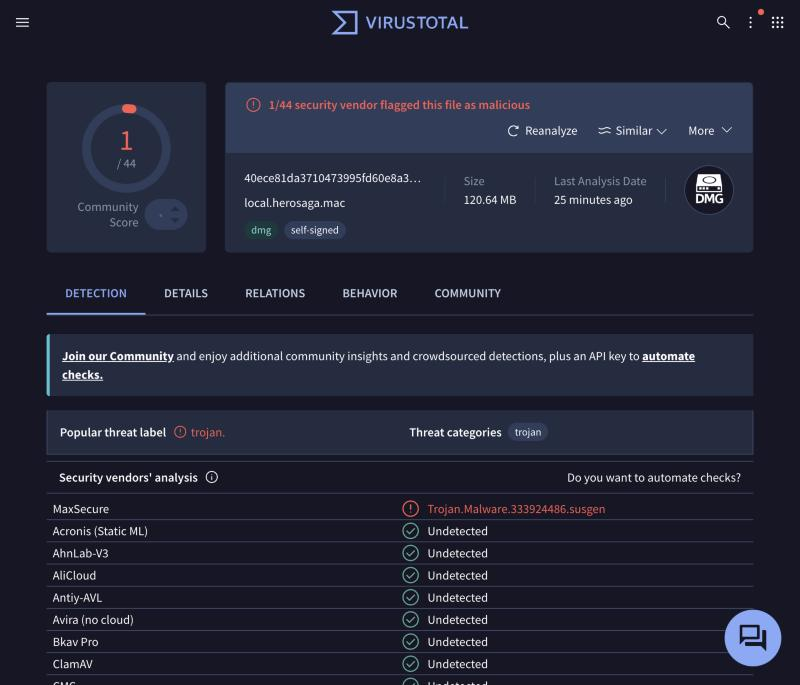

# Hero Saga para Mac — Relatório de segurança

Este documento reúne as verificações feitas para mostrar que o programa não contém vírus nem código malicioso, e explica como qualquer pessoa pode repetir cada teste.

## 1. Identificação dos arquivos (SHA-256)

O SHA-256 funciona como uma "impressão digital" do arquivo: se um único byte mudar, o valor muda completamente.

| Arquivo | SHA-256 |
|---|---|
| `HeroSagaParaMac-1.0.dmg` | `40ece81da3710473995fd60e8a39f5484d3798a99e9ab379457e975ef83b0a89` |
| Launcher (`Contents/MacOS/HeroSagaMac`) | `54010e304426ce314766b14f4829ffe68b48236461b55d7ee630b4c2b7fdfaa2` |
| Motor: `WS12WineCX24.0.7_7.tar.xz` (Sikarugir) | `203f9e9fd6c2cc77e6525d798a434ced326145db34a356355e05659d3445fd1c` |
| Bibliotecas: `wine-staging-11.21-osx64.tar.xz` (Gcenx) | `d7bcd5abf4df27aae397a7898aef074fea4a2e0b51e0a55aa9659517bbf9d452` |

Para conferir o .dmg baixado:
```
shasum -a 256 HeroSagaParaMac-1.0.dmg
```
O resultado precisa ser igual ao da tabela e ao arquivo `.sha256` publicado no *Release*.

## 2. Origem de cada componente

| Componente | Origem | Modificado? |
|---|---|---|
| Launcher | Código-fonte deste repositório (`Sources/HeroSagaMac.swift`) | Código próprio, aberto para leitura |
| Motor Wine (`engine/wswine.bundle`) | github.com/Sikarugir-App/Engines (WineCX 24.0.7, código aberto do CrossOver) | **Não** |
| Bibliotecas de apoio (`engine/*.dylib`) | github.com/Gcenx/macOS_Wine_builds (release 11.21) | **Não**. Só os arquivos `.dylib` do macOS são usados; nenhum programa Windows do pacote é incluído |

### Teste: o motor é idêntico ao oficial
O script `tools/verify-engine.sh` baixa os pacotes oficiais, confere o SHA-256 de cada um e compara **todos os arquivos** com os que estão dentro do app.

```
tools/verify-engine.sh "/Applications/Hero Saga para Mac.app"
```
Resultado em 23/11/2026:
```
OK: todos os arquivos do motor são idênticos aos oficiais.
```

## 3. Análise do launcher (código próprio)

- **Código aberto:** ~450 linhas de Swift em um único arquivo, para qualquer pessoa ler.
- **Sem acesso à internet:** o executável não contém nenhuma URL (`strings | grep http` = 0 resultados) e não usa APIs de rede (`URLSession`, sockets).
- **Bibliotecas usadas** (`otool -L`): somente frameworks da própria Apple (AppKit, SwiftUI, Foundation, Combine, CoreGraphics, libSystem, libobjc).
- **O que ele executa:** apenas o `wine` embutido, com `wineboot`, `reg add` (três chaves vazias), `Hero.exe` e `Atualizador Hero Saga.exe`. Também roda `/usr/bin/pgrep` para saber se o jogo já está aberto.
- **O que ele grava:** `~/Library/Application Support/HeroSagaMac/` (configuração e ambiente Windows), `~/Library/Logs/HeroSagaMac.log`, e dois arquivos de opções dentro da pasta do jogo (`savedata/OptionInfo.lua`, `savedata/HeroOptions.ini`), com backup do original.
- **Não pede senha de administrador** e não instala nada fora dessas pastas.

## 4. Assinatura de código

```
codesign --verify --deep --strict "Hero Saga para Mac.app"   → válido
```
A assinatura é *ad-hoc*: garante que nenhum arquivo do app foi alterado depois de gerado, mas não identifica um desenvolvedor registrado na Apple. Por isso o macOS mostra um aviso na primeira abertura. Para remover o aviso é preciso uma conta Apple Developer (US$ 99/ano) e notarização.

O macOS também passa o app pelo **XProtect** (antivírus embutido) na primeira abertura de um arquivo baixado da internet.

## 5. VirusTotal (≈70 antivírus)

| Arquivo | Resultado | Link |
|---|---|---|
| Motor WineCX (`WS12WineCX24.0.7_7.tar.xz`) | **0 / 42**: nenhum antivírus detectou nada | [virustotal.com/gui/file/203f9e9f…](https://www.virustotal.com/gui/file/203f9e9fd6c2cc77e6525d798a434ced326145db34a356355e05659d3445fd1c) |
| Pacote Gcenx Wine Staging 11.21 (completo) | 8 / 47 alertas genéricos ("Malware-gen", "fakeav", "Static AI") | [virustotal.com/gui/file/d7bcd5ab…](https://www.virustotal.com/gui/file/d7bcd5abf4df27aae397a7898aef074fea4a2e0b51e0a55aa9659517bbf9d452) |
| **`HeroSagaParaMac-1.0.dmg`** | **1 / 44**: só o MaxSecure, com alerta heurístico genérico (`Trojan.Malware.333924486.susgen`) | [virustotal.com/gui/file/40ece81d…](https://www.virustotal.com/gui/file/40ece81da3710473995fd60e8a39f5484d3798a99e9ab379457e975ef83b0a89/detection) |



**Resultado do .dmg (análise de 23/11/2026):**
- **43 antivírus não detectaram nada**, incluindo Microsoft Defender, CrowdStrike Falcon, Malwarebytes, Symantec, McAfee, Trellix, Fortinet, Google, Panda, DrWeb, GData, WithSecure, Avira, ClamAV e TrendMicro HouseCall.
- **1 alerta (MaxSecure):** o sufixo `susgen` significa *suspicious generic*, uma suspeita por heurística e não a identificação de um vírus conhecido. O MaxSecure é conhecido por falsos positivos em arquivos novos, sem assinatura paga e com pouca "reputação", que é o caso de um .dmg recém-criado e assinado de forma ad-hoc.
- **16 antivírus não terminaram a análise** (*timeout*: Kaspersky, ESET, BitDefender, Sophos, Avast, AVG e outros) por causa do tamanho do arquivo (121 MB). Clicar em **Reanalyze** no VirusTotal depois de alguns dias costuma completar essas análises.

**Sobre os alertas do pacote Gcenx:** o pacote completo traz centenas de programas e DLLs do Windows recompilados pelo Wine. Antivírus baseados em heurística/IA costumam marcar esse tipo de arquivo como genérico, um falso positivo conhecido em distribuições do Wine. Os grandes antivírus que analisaram o pacote (Microsoft, ESET-NOD32, CrowdStrike Falcon, Malwarebytes, Symantec, McAfee, Fortinet, Panda e ClamAV) não detectaram nada. Kaspersky, BitDefender e Sophos não chegaram a analisar (*timeout*) por causa do tamanho do pacote. **O Hero Saga para Mac não inclui esses programas Windows:** do pacote são usados só os arquivos `.dylib` (bibliotecas do macOS, como FreeType e GnuTLS). O teste definitivo é o resultado do próprio `.dmg`, logo acima.

### Como enviar o .dmg ao VirusTotal
1. Acesse https://www.virustotal.com e clique em **Choose file**.
2. Selecione `HeroSagaParaMac-1.0.dmg` e aguarde a análise (alguns minutos).
3. Copie o link da página de resultado e publique junto ao *Release*.

## 6. Como qualquer pessoa pode auditar

1. Ler o código: `Sources/HeroSagaMac.swift`.
2. Compilar do zero: `./build.sh` (baixa o motor das fontes oficiais com conferência de SHA-256).
3. Comparar o motor: `tools/verify-engine.sh`.
4. Conferir o hash do .dmg com o publicado.
